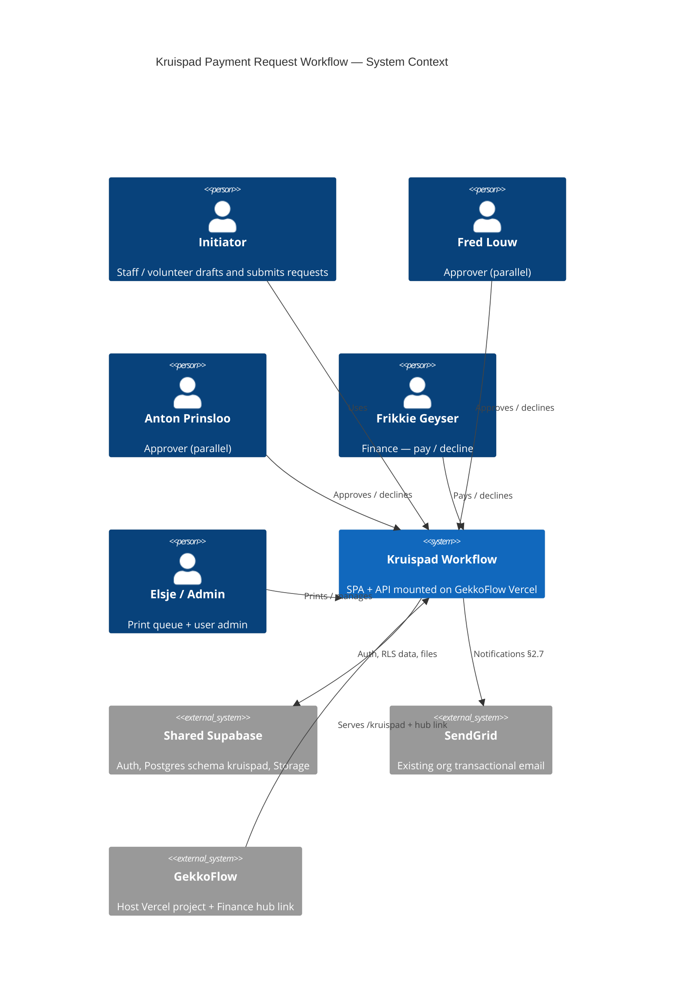
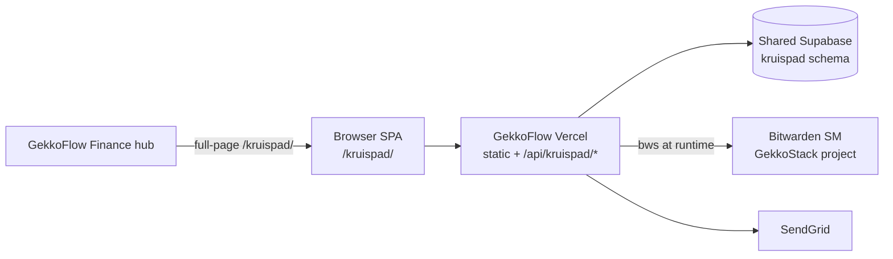

# ARCHITECTURE — Kruispad Payment Request Workflow

**Status:** Accepted · **Date:** 2026-10-28 · **Linear:** [GST-459](https://linear.app/gekkotech/issue/GST-459/kruispad-payment-request-workflow-app-v1)  
**Repo:** https://github.com/EswanHoll/Kruispad  
**Behaviour spec:** [WorkflowApp/Payment_Request_Approval_Workflow_Spec.md](../../WorkflowApp/Payment_Request_Approval_Workflow_Spec.md) v1.3

## Purpose

Digitise Kruispad expense submission, **parallel dual approval** (Fred Louw + Anton Prinsloo), Finance payment, and Admin document print/file — with role-based UI, private attachments, audit trail, and email notifications.

## Non-goals

- Multi-tenant SaaS (single organisation)
- Sandbox / Manus preview as product host ([portfolio ADR-0015](https://github.com/EswanHoll/GekkoStack/blob/main/docs/portfolio-architecture/decisions/ADR-0015-no-sandbox-product-builds.md))
- A separate Kruispad Vercel or Supabase project ([ADR-0001](adr/0001-stack-and-host.md))
- Seeding real user accounts from this repo

## Stack (overrides spec §2.1)

| Layer | Choice | Notes |
|-------|--------|-------|
| Host | **Existing GekkoFlow Vercel project** | Mount at `/kruispad/` + `/api/kruispad/*` — no own Vercel project |
| Frontend | React 19 + Vite + TypeScript + Tailwind | `base` / `basename` = `/kruispad` |
| Auth / DB / Storage | **Existing shared Supabase** | Schema **`kruispad`** only — no new Supabase project ([ADR-0003](adr/0003-email-action-links-and-shared-schema.md)) |
| State machine | `kruispad` RPCs (`SECURITY DEFINER`) + `audit_events` | Concurrent dual approval under row lock |
| Email actions | SendGrid + `/kruispad/action/:token` | Reuse `SENDGRID_API_KEY` / `SENDGRID_FROM_EMAIL`; single-use tokens; no HTML forms in email |
| Auth UX | Magic link (`shouldCreateUser: false`) | Invite-only profiles; approvers/finance/admin act via email links |
| Secrets | Bitwarden (`bws`) | `SUPABASE_*__SHARED` + existing SendGrid names + `APP_BASE_URL__PROJ_KRUISPAD` + notify secret |

Decision records: [ADR-0001](adr/0001-stack-and-host.md), [ADR-0002](adr/0002-parallel-approval-state-machine.md), [ADR-0003](adr/0003-email-action-links-and-shared-schema.md). Mount: [GEKKOFLOW_HOSTING.md](GEKKOFLOW_HOSTING.md).

## Context (C4 L1)



## Container sketch



## Roles → capabilities

| Role | Capabilities |
|------|----------------|
| `initiator` | Create/edit drafts, submit, view own requests |
| `approver_fred` | Approval queue — Fred approve/decline |
| `approver_anton` | Approval queue — Anton approve/decline |
| `finance` | Payment queue — pay / decline with reason |
| `admin` | Print queue, all requests, manage profiles |

Macro statuses: `drafted` → `submitted` → `fully_approved` → `paid` → `document_printed`. Decline at any approval/payment stage resets to `drafted` and clears approver fields.

## GekkoFlow hub linking

GekkoFlow **hosts** this app (same Vercel project) and links from Finance:

| Concern | Contract |
|---------|----------|
| Base URL | Production `https://gekkoflow.com/kruispad` (`APP_BASE_URL__PROJ_KRUISPAD`); local `http://localhost:5173/kruispad` |
| Deep links | `/` dashboard · `/requests/new` · `/requests/:id` · `/my-requests` · `/queues/approval` · `/queues/payment` · `/queues/print` · `/all-requests` · `/login` · `/action/:token` |
| Auth | Shared Supabase Auth magic link. Roles in `kruispad.profiles`. |
| Hub chrome | Finance L2 **Kruispad** → full-page navigation to `/kruispad/` (leaves GekkoFlow SPA) |
| Return | Optional `?from=gekkoflow` — UI shows “Back to GekkoFlow” → `https://gekkoflow.com` |

Do not couple Kruispad schema tables into GekkoFlow-DB ORM. Data plane stays `kruispad.*` on shared Supabase.

## Email action flow

```mermaid
sequenceDiagram
  participant App as GekkoFlow-hosted app
  participant API as /api/kruispad/notify
  participant Mail as SendGrid
  participant User as Approver/Finance
  participant Act as /kruispad/action/:token
  participant DB as kruispad RPCs

  App->>DB: transition (session or prior email)
  App->>API: POST notify
  API->>DB: mint_action_token (hash stored)
  API->>Mail: summary + attachment links + Approve/Decline URLs
  User->>Act: open link (no login)
  Act->>DB: peek_action_token / execute_email_action
  Note over DB: same apply_* helpers; audit channel=email_link
```

## Constraints

- Secrets: names only in git; values only in Bitwarden ([SECRETS_INVENTORY.md](SECRETS_INVENTORY.md)).
- Attachments: private Storage bucket `kruispad-attachments` (PDF/JPG/PNG).
- PostgREST must expose schema `kruispad` on the shared project.
- CI: lint, typecheck, test — no secrets in GitHub Actions.
- Deploy: prepare mount → GekkoFlow `build:vercel`; apply migrations to shared Supabase with BWS-hydrated credentials.
